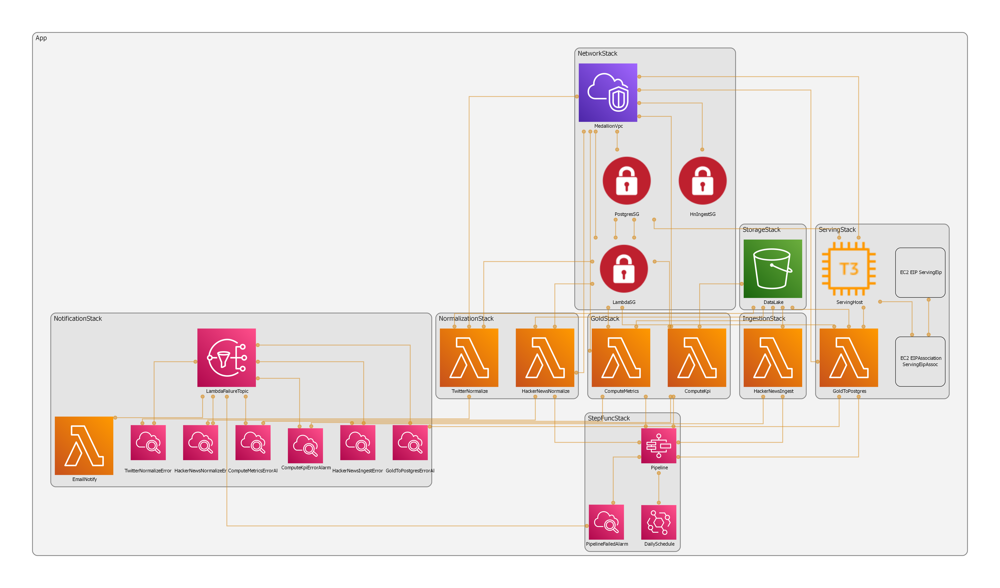

# Medallion Data Platform

A cloud-native **data platform on AWS** that collects, normalizes, transforms and visualizes data from social and blog sources: **Hacker News** and **X (Twitter)**. It ingests raw content daily, refines it through a **bronze → silver → gold** medallion pipeline, computes engagement metrics and data-quality KPIs, and serves them in interactive **Apache Superset** dashboards.

Built as the project for the **Cloud Computing** course (*Računarstvo u oblaku*). The whole platform (the VPC, the S3 data lake, seven Lambda functions, a Step Functions pipeline, an EC2 serving host and the alarm/notification wiring) is defined in **AWS CDK (Python)** and deployed to `eu-central-1`.

---

## 👥 Authors

- [**Vukašin Vitomirović**](https://github.com/Kakodane)
- [**Miloš Damjanović**](https://github.com/pifchina)
- [**Ognjen Vujović**](https://github.com/ognjenvujovic04)

---

## Architecture

The whole platform is one CDK app of eight stacks. Data flows left to right through the medallion layers; a daily Step Functions state machine orchestrates the run, and every Lambda is watched by a CloudWatch alarm that emails the team on failure.



> *Auto-generated from the synthesized CloudFormation: every box is a real resource defined in `medallion-data-platform/stacks/`.*

**Data flow:** `HackerNewsIngest` plus the Twitter dataset land raw JSON/CSV in **bronze**, then `HackerNewsNormalize` / `TwitterNormalize` conform both sources to one Parquet schema in **silver**, then `ComputeMetrics` / `ComputeKpi` roll them up into metric tables in **gold**, and finally `GoldToPostgres` upserts gold into PostgreSQL, where **Superset** reads it. `StepFuncStack` chains the steps daily; `NotificationStack` emails on any failure.

---

## What the system does

| Capability | How it's implemented |
| ---------- | -------------------- |
| **Bronze, daily ingestion** | The `HackerNewsIngest` Lambda pulls the previous day's stories, asks, comments, jobs and polls from the **Algolia HN Search API** and writes them **untouched** as JSONL to `bronze/hackernews/year=/month=/day=/`. No cleaning is allowed in bronze; it is the raw system of record. |
| **Bronze, Twitter dataset** | A ~1 GB / 2.5 M-row Kaggle *Bitcoin Tweets* dataset is uploaded once to `bronze/twitter/` and used as the X data source (the free X API is too limited to poll). |
| **Silver, normalization** | Two Lambdas flatten nested structures (HN `kids`), collapse time formats (HN Unix epoch and X ISO-8601 into one `YYYY-MM-DDTHH:MM:SSZ` UTC form), strip HTML tags, drop duplicates, and conform everything to a shared **3NF schema** of `posts` and `users` tables written as **partitioned Parquet**. |
| **Deterministic, idempotent IDs** | `uuid5` over a fixed namespace means the same logical user/post always maps to the same id, so re-runs never create duplicates. `upsert_users` keeps the earliest row per user so state accumulates cleanly across daily/chunked runs. |
| **Gold, metrics** | `ComputeMetrics` produces five metric tables: daily post counts by type, daily user counts per platform, top-10 X users by followers, top-10 HN users by highest **and** lowest karma, and top-10 HN jobs/stories by score. |
| **Gold, data-quality KPI** | `ComputeKpi` computes a **Data Quality Score**, the percentage of non-null cells per table, as a measure of how well normalization performed. |
| **Serving, Postgres + Superset** | Since Superset can't read S3 Parquet directly, `GoldToPostgres` **upserts** every gold table into PostgreSQL 16 (over `pg8000`, keyed on each table's natural key). Both Postgres and Superset run in Docker on a single **t3.micro** EC2 host, fronted by an Elastic IP. |
| **Serving, dashboards as code** | A `superset-init` bootstrap provisions the datasource, one dataset per gold table, 8 charts and 4 dashboards **entirely over the Superset REST API**: idempotent and reproducible, never clicked together by hand. |
| **Orchestration** | A **Step Functions** state machine chains ingest, normalize, parallel metrics/KPI, then load, on an EventBridge daily cron (01:00 UTC), with exponential retries on transient Lambda errors. |
| **Failure notifications** | One CloudWatch alarm per Lambda (plus a pipeline-level alarm) publishes to an SNS topic; an `EmailNotify` Lambda sends an **SES email** on every `ALARM` transition. |
| **Least-privilege networking** | Everything lives inside a **VPC**. Lambdas sit behind a `lambda_sg`; Postgres only accepts `5432` from that group; Superset/SSH ingress is scoped to a single admin IP. Each stack grants itself only the S3 prefix it needs. |

---

## The stacks (`app.py`)

| Stack | Layer | What it creates |
| ----- | ----- | --------------- |
| **NetworkStack** | foundation | VPC, public / private-isolated subnets, shared `lambda_sg` & `postgres_sg` security groups |
| **StorageStack** | foundation | the single versioned S3 data-lake bucket, passed by reference into every other stack |
| **IngestionStack** | bronze | `HackerNewsIngest` Lambda (Algolia HN Search API to raw JSONL) |
| **NormalizationStack** | silver | `HackerNewsNormalize` + `TwitterNormalize` Lambdas (awswrangler layer, Parquet out) |
| **GoldStack** | gold | `ComputeMetrics` (5 metric tables) + `ComputeKpi` (data-quality KPI) |
| **ServingStack** | serving | t3.micro EC2 (Postgres + Superset in Docker) + `GoldToPostgres` load Lambda |
| **NotificationStack** | ops | per-Lambda CloudWatch alarms into SNS into SES `EmailNotify` |
| **StepFuncStack** | ops | the daily state machine orchestrating the whole pipeline |

`ServingStack` and `NotificationStack` are only synthesized when their secrets are supplied (`-c db_password=…`, `-c notification_email=…`), so the rest of the app still `cdk ls` / `cdk synth`s cleanly without them.

---

## Tech Stack

**Cloud & platform**
* **AWS CDK 2 (Python)** for the entire cloud footprint as typed constructs; `cdk synth` / `cdk deploy` per stack.
* **AWS Lambda (Python 3.12)** for ingestion, normalization, gold transforms, Postgres loading and email notifications: seven functions in all.
* **AWS Step Functions + EventBridge** for daily orchestration with retries; the pipeline is one state machine, not a cron soup.
* **Amazon S3** as the medallion data lake (bronze / silver / gold), versioned and prefix-partitioned.
* **Amazon EC2 (t3.micro)** as the Docker host for the serving layer, on an Elastic IP inside the VPC.
* **CloudWatch + SNS + SES** for alarm-driven failure emails.
* **VPC + Security Groups** for least-privilege network isolation across every service.

**Data processing**
* **AWS SDK for pandas (awswrangler)** for reading/writing partitioned Parquet from Lambda via the public managed layer.
* **pandas** for the normalization and metric/KPI transforms.
* **Parquet** for columnar, partitioned storage in the silver & gold layers.
* **pg8000** as the pure-Python Postgres driver (bundled in the pandas layer) for the upsert load.

**Serving & visualization**
* **PostgreSQL 16** as the query-serving store for gold metrics.
* **Apache Superset 3.1** for dashboards, provisioned by code over its REST API.
* **Docker Compose** to bring up Postgres + Superset + a one-shot init from EC2 user-data.

---

## Quick start

**Prerequisites:** an AWS account with credentials configured (`aws configure`) for `eu-central-1`, **Python 3.12+**, and the **AWS CDK CLI**. Docker is only needed on the EC2 host, which is provisioned automatically.

```powershell
# from the CDK app root: medallion-data-platform/, not the git root
cd medallion-data-platform
python -m venv .venv
.venv\Scripts\activate.bat
pip install -r requirements.txt -r requirements-dev.txt

cdk bootstrap aws://<ACCOUNT_ID>/eu-central-1   # once per account/region

# 1. foundation
cdk deploy NetworkStack StorageStack

# 2. bronze / silver / gold lambdas
cdk deploy IngestionStack NormalizationStack GoldStack

# 3. daily orchestration
cdk deploy StepFuncStack

# 4. serving layer (needs deploy-time secrets)
cdk deploy ServingStack `
  -c db_password=<CHOOSE_STRONG_PW> `
  -c admin_ip=<YOUR_PUBLIC_IP> `
  -c key_name=<EXISTING_EC2_KEYPAIR>
```

Once `GoldToPostgres` has loaded the gold tables, open Superset at `http://<ELASTIC_IP>:8088` and the four dashboards render automatically.

> **Full walkthrough** (deploy order, the one-time Twitter backfill, invoking each Lambda and validating its output, and the Superset dashboards) is in
> [`medallion-data-platform/README.md`](medallion-data-platform/README.md), with deeper runbooks in
> [`lambdas/README.md`](medallion-data-platform/lambdas/README.md),
> [`ec2/README.md`](medallion-data-platform/ec2/README.md) and
> [`data/bitcoin-tweets/README.md`](medallion-data-platform/data/bitcoin-tweets/README.md).

The full assignment specification (Serbian) is in [`Specifikacija projekta.pdf`](Specifikacija%20projekta.pdf).
